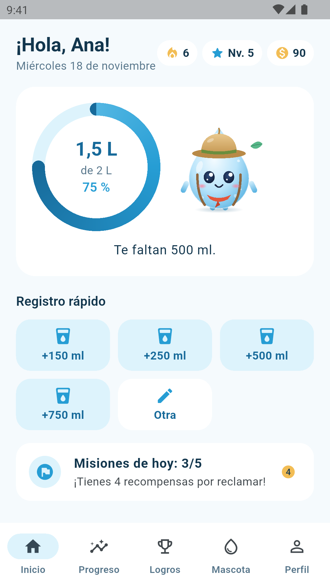
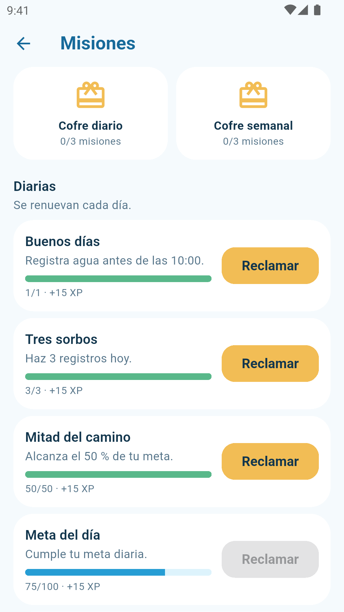
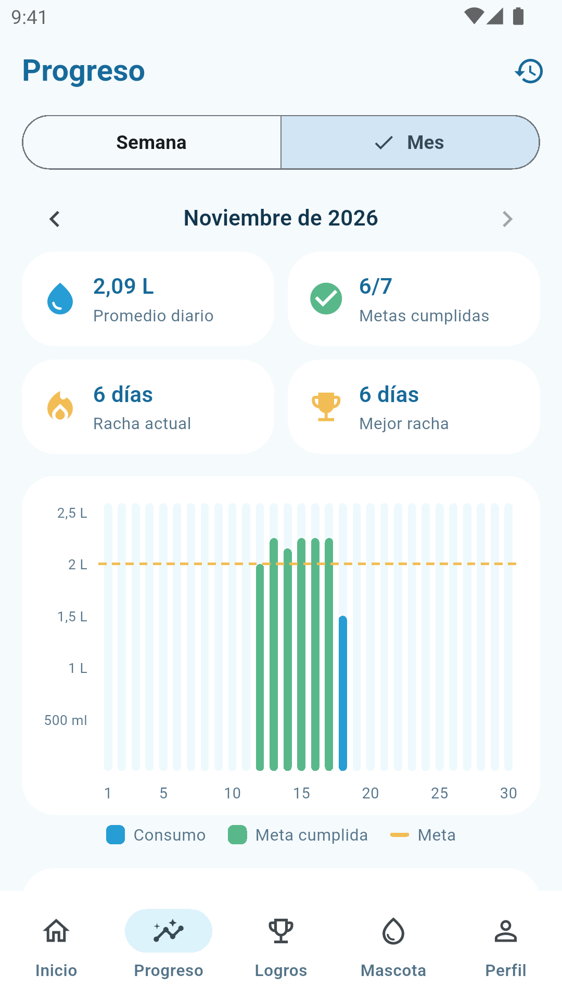
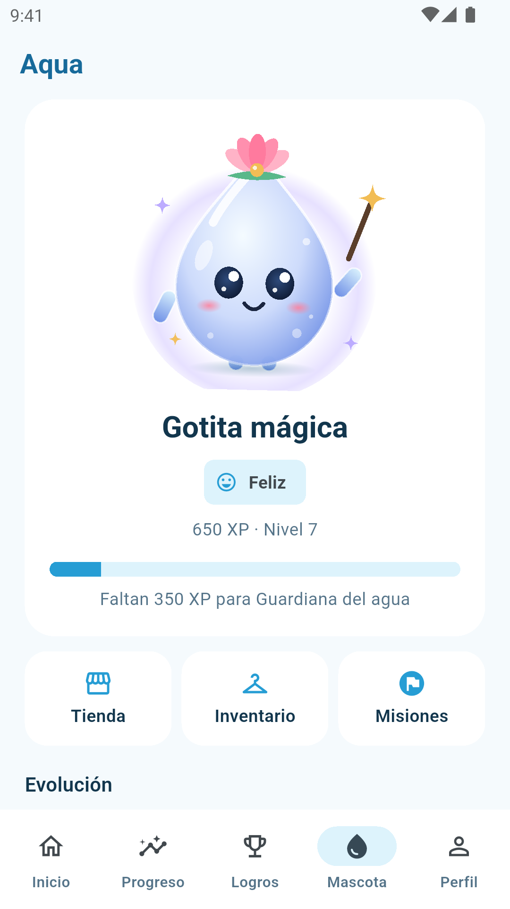

# AquaLife

Aplicación móvil de hidratación gamificada (Android e iOS), local-first y sin backend.
Especificación completa: [AquaLife_Requerimientos_y_Especificacion.pdf](AquaLife_Requerimientos_y_Especificacion.pdf).

- Identificador: `dev.josueeb.aqualife`
- Stack: Flutter · Riverpod · GoRouter · Drift (SQLite) · flutter_local_notifications · fl_chart · Lottie
- Requiere Flutter ≥ 3.47 (Dart ^3.14); probado con Flutter 3.50
- Versión: 1.0.0+1 · Android listo para firmar y publicar; iOS pendiente de compilar (ver abajo)

| Inicio | Misiones | Progreso | Aqua |
|---|---|---|---|
|  |  |  |  |

## Puesta en marcha

```bash
flutter pub get
dart run build_runner build      # genera el código de Drift (*.g.dart)
flutter test
flutter run
```

## Publicación

Guía completa en [docs/PUBLICACION.md](docs/PUBLICACION.md): firma (`android/key.properties`),
`flutter build appbundle` / `flutter build ipa`, checklist de pruebas en dispositivos reales,
textos de las fichas y respuestas de privacidad. Capturas de tienda (1080×1920) en
[docs/screenshots/android/](docs/screenshots/android/).

## Estructura

```
lib/
  app/        aplicación raíz, router (GoRouter) y tema
  core/       base de datos (Drift), constantes, utilidades, providers base
  features/   una carpeta por funcionalidad con data / domain / presentation
  shared/     widgets reutilizables
assets/images/mascot/stage_1..5/   ilustraciones de Aqua
tool/mascot/                       generadores de los SVG de Aqua y sus accesorios, con vistas previas
test/{unit,integration,widget}/
```

## Reglas de gamificación (fijadas)

Centralizadas en `lib/core/constants/gamification_rules.dart`.

| Regla | Valor |
|---|---|
| Registro válido | 5 XP, máximo 10 registros premiados por día |
| Meta diaria | 50 XP, una vez por día |
| Misión diaria / semanal | 15 XP / 100 XP |
| Racha de 7 días | 100 XP |
| Monedas | 1 por cada 10 XP del evento |
| Nivel | 1 + XP total / 100 |
| Cantidad válida por registro | 1–2000 ml |
| Etapas de Aqua | 0 / 100 / 300 / 600 / 1000 XP |

Las recompensas se registran en el ledger `reward_transactions` con clave única
`(usuario, tipo, fuente, referencia)`, dentro de la misma transacción que el consumo.

## Reglas adicionales

- Solo se pueden registrar o editar consumos de los últimos 7 días.
- XP y monedas solo se otorgan por cambios en el día de hoy; los días pasados cuentan para historial, rachas y logros.
- La racha se cuenta hasta ayer mientras la meta de hoy no se cumple (no punitiva); la mejor racha nunca baja.
- Misiones: se calculan desde los registros reales y se reclaman a mano (15 XP diarias, 100 XP semanales).
- Cofres: el diario se abre al reclamar 3 misiones del día; el semanal, al reclamar todas las semanales.
  Dan solo monedas, deterministas por fecha (reintentar no cambia el premio).
- Tienda: solo cosméticos con monedas ganadas en la app; cada compra queda en el ledger como movimiento negativo.
- Recordatorios: se programan hasta 48 avisos concretos (límite de iOS: 64) y se reprograman al abrir la app,
  al registrar agua y al cambiar la configuración.

## Política temporal

`consumed_at` se guarda en UTC y cada consumo guarda su fecha local de agrupación
(`local_date`) calculada al registrarlo. Cambiar de zona horaria no mueve consumos pasados.

## Roadmap

- [x] 1. Foundation (estructura, tema, Riverpod, GoRouter, Drift, onboarding, navegación, Inicio)
- [x] 2. Base de datos (esquema v1, DAOs, pruebas con Drift en memoria)
- [x] 3. Hidratación (historial con calendario, edición de los últimos 7 días, accesos rápidos configurables, ajustes)
- [x] 4. Recordatorios (horario, intervalo, días, posponer, se pausan al cumplir la meta)
- [x] 5. Estadísticas (semana/mes, gráfico, calendario de actividad, rachas)
- [x] 6. Gamificación (rachas, hito de 7 días, logros con monedas)
- [x] 7. Mascota (estados de ánimo animados en código, 12 accesorios equipables por categoría)
- [x] 8. Misiones diarias/semanales, cofres, tienda cosmética e inventario
- [x] Exportación e importación de respaldo JSON
- [x] 9. QA y publicación: ícono de la app, firma de release, 55 pruebas (incluye recorrido de las 13 pantallas
  y programación de recordatorios), APK de release verificado, capturas de tienda y guía de publicación

### Pendiente antes de las tiendas

- Pruebas manuales en un Android y un iPhone reales (checklist en `docs/PUBLICACION.md`).
- iOS: Xcode 26.5 necesita la plataforma iOS 26.5 (Xcode › Settings › Components) para compilar;
  después, capturas de iPhone 6,9" y firma con tu equipo de Apple.
- Ícono de 1024 px nítido: el actual se escaló desde 512 px.
- Publicar la política de privacidad en una URL y crear las cuentas de desarrollador.
